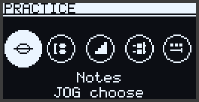
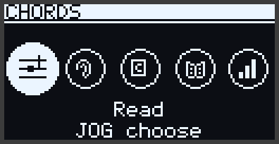
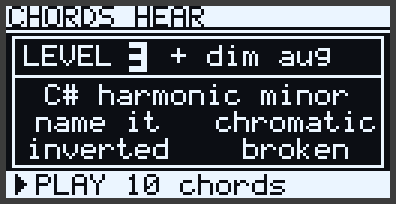
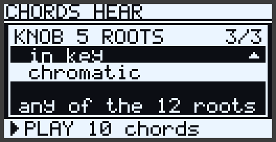
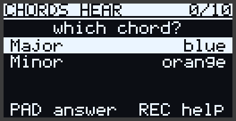
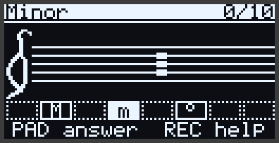
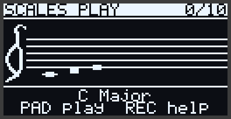
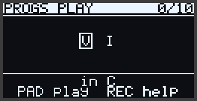
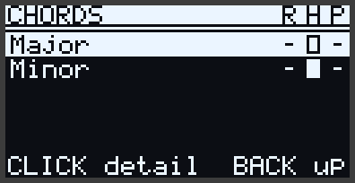

# Practice: five trainers, one way to practise

Practice is five trainers, from the smallest unit of music to the largest:

1. **Notes** — one pitch: where it is on the staff, and where it is on the pads.
2. **Intervals** — two notes: the step from single notes to everything harmonic.
3. **Scales** — the alphabet a key is spelled in.
4. **Chords** — three or more notes at once.
5. **Progressions** — chords in time, from the cadence that ends a phrase to the 12-bar blues.

The idea behind them is simple: **the subject changes, the way to practise it never does.** Every
trainer has the same five circles, in the same order, with the same keys. Once you know one, you
know all five.

## The five circles

Open a trainer and you see its ring: five circles, the same in every trainer.

| Circle | The skill | An example from Chords |
| --- | --- | --- |
| **Read** | from the staff to the pads, or to a name | an A minor chord on the staff: play it, or say it is minor |
| **Hear** | from the sound to the pads, or to a name | a chord sounds: play it back, or say what kind it is |
| **Play** | from a name to the pads | `Am7`: play it, in any inversion |
| **Learn** | the lessons, played along a scrolling staff | the chord lessons, family by family |
| **Stats** | what you know, and what you do not yet | Major right 9 times of 10 by ear, minor 4 of 10 |

Read, Hear and Play are the three ways a musician meets anything: written down, heard, or named.
Practising one subject all three ways is what joins them up. You read a chord and hear it; you hear
it and find it; you are told its name and play it.

## Setting up a round

Read, Hear and Play each open a **setup page** that shows the settings, not the knobs: the
**LEVEL** across the top with its big number and what that level adds, then the settings this
circle really has, each in words that say what it is — `C# harmonic minor`, `name it`,
`chromatic`, `broken chords` — and at the bottom a bar that says what PLAY starts:
**▶ PLAY 10 chords**. Notes › Play shows only its level; Chords › Hear all of it.

**Touch a knob** and an overlay opens over the page: which knob it is, what it changes, three of its
options with the one set in the middle, and a line on what that option means. **Turn** it and the
list steps one option at a time; a deliberate turn is one value, never racing. **Let go** and the
overlay closes a moment later. LEVEL is knob 1 in every trainer, then the knobs follow the page in
reading order, Round last.

- **BACK** closes the overlay at once and stays on the page; **PLAY** closes it and starts.
- A knob this circle has no setting for says which knobs do.
- The jog walks the knobs too, **Shift + click** shows the setup as a list, and the page remembers
  what you set, for each trainer and each circle.

What the settings are:

- **Answer** — how you answer: **play** it on the pads, or **name** it from a short list. Intervals
  can also **compare** two (which is bigger?). Notes heard are **played back** or answered **higher
  or lower**: naming a single pitch out of nowhere is not a skill worth drilling. Play has no answer
  to choose; you always play.
- **Level** — the trainer's ladder, simple first (below). **Custom** lets you tick your own set:
  turned to Custom, **click** opens the tick list. A new Custom pick starts as the level you came
  from, and PLAY waits until it has enough — one thing to play, two to tell apart when naming. While
  it waits, the PLAY light is dark and the bar says what is missing (`tick 2 chords`).
- **Key** — the key a round is in, or **random**. For progressions there is also **all 12**: the
  same progression in every key, walking round the circle of fifths.
- The subject's own rows: for chords the key's **Scale**, which **Roots** (diatonic — only the
  chords of the key —, in key, or chromatic) and **Inversions**; for scales the **Direction** and
  the **Pattern** (straight, in 3rds, in 5ths); for intervals the **Direction** (up, down,
  together); for progressions the **Voicing** and the **Rhythm**.
- **Round** — how many right answers make a round: 10, 20, 30, or endless.

## A round

A round asks until you have given the right answer as many times as the Round says. A wrong answer
counts once and the question stays: getting it right is what moves you on. The score is how many
right answers a minute, and how many of your attempts were right.

**Naming.** The answers are on the bottom row of pads, each its own colour, and the screen is the
legend: wherever pads answer, the screen says which pad is which. You get at most eight: the right
one and its nearest near misses, in the same order every time, so where an answer sits becomes
habit.

- **Heard**, four answers or fewer are a list, each with the colour of its pad; more are a map of
  cells, each over its pad, holding the answer's short name.

- **Read**, the staff needs the screen, so under it sits an **answer strip**: one cell per answer,
  over its pad's column, the same cells as the Hear map. The column of a pad with no answer is
  dotted, so the row reads as the pads it is. The jog's choice is filled, and its full name is in
  the title; an answer Help struck out is crossed through.

**Playing.** What counts depends on the circle:

- **Read and play**: exactly what is written, every note in its octave.
- **Hear and play back**, **Play from a name**: any octave and any voicing. `Am` is A, C and E in
  any order, anywhere on the grid.
- A **scale** or an **interval** goes note by note. The staff fills as you play, and a wrong note
  starts it again. An interval from its name keeps its distance: *M3 above D* is any D, and then the
  F♯ a major 3rd above that D.

- A **progression** goes chord by chord, each in any voicing. Its numerals stand where the staff
  is, and each one inverts as its chord goes down.

**Help** is **REC**, two presses deep: heard, it plays the question again, slower; then it strikes
out a wrong answer, or names what you are finding. A hinted answer still counts, but the round
records how many hints you took.

**Back** from a round is its setup page; from there, the
trainer's ring. From a result,
**CLICK** runs another round as set up.

## The ladders

Each trainer's Level row walks a ladder, easiest first. Every level adds to the ones below it,
except Intervals, whose levels are sets of their own, as the course has always run: a contrasting
pair, then the pair with its neighbours.

| Trainer | 1 | 2 | 3 | 4 | 5 | 6 | 7 | 8 | 9 | 10 |
| --- | --- | --- | --- | --- | --- | --- | --- | --- | --- | --- |
| Notes | C–G round middle C | + A B | two octaves | + sharps, flats | + E♯ F♭ B♯ C♭ | | | | | |
| Intervals | 2nds | 3rds | 2nds and 3rds | 4th 5th octave | to the 5th | 6ths 7ths | to the octave | compound | | |
| Scales | major, minor | + Dorian, Lydian, Mixolydian | + harmonic, melodic minor | + Phrygian, Locrian | + pentatonics, blues | + whole tone and kin | + diminished | + melodic-minor modes | + harmonic-minor modes | + six more from India, Hungary, Japan |
| Chords | major | + minor | + dim, aug | + sus, power | + 7, maj7, m7 | + m7b5, dim7, 6ths | + 9ths, add9 | + altered dominants | | |
| Progressions | cadences | + I–IV–V–I, Axis | + pop | + minor | + jazz basics | + blues | + borrowed, modal | + secondary, tritone sub, backdoor, Pachelbel | | |

Progressions begin with the **cadences** — authentic (V–I), plagal (IV–I), half (…–V) and
deceptive (V–vi) — because how a phrase ends is the first thing harmony teaches the ear.

## Learn

**Learn** is the trainer's lessons: the material Practice has always had, now with its subject.

| Trainer | Learn holds |
| --- | --- |
| Notes | random reading lines: in the key, fast, and every note the pads reach |
| Intervals | Step or leap, Melody shape |
| Scales | a folder for each of Move's 22 scales, then Major or minor key and Scale degrees |
| Chords | thirteen families of chord lessons, then random chords |
| Progressions | eleven progression charts, then Home or away and Chords in a key |

Everything keeps the name it had, so your progress and the Learning Path's steps are where they
were.

## Stats

Every answer you give, in any trainer and on any step of the Learning Path that asks one, is filed
under what it was about: a note name, an interval, a scale, a chord quality, a progression. **Stats**
lists them weakest first, with a meter each for **R**ead, **H**eard and **P**layed. Click a row for
its numbers.

The same numbers steer the rounds: what you miss comes up more often, in every round of that
subject, until you stop missing it.

## On the page

In a browser the trainers work the same way: the rings, the setup page as cards with a picker each,
the answer buttons in their pad colours, and Stats as a table with a chart of the row you pick.
See [the page](web.md#trainers).

## What changed for the drills you knew

The Quiz menu is gone; its drills are trainer rounds now, and they keep their names wherever they
appear — on the Learning Path, in Review, in Progress — so nothing you did is lost.

| Before | Now |
| --- | --- |
| Keys › Notes by alphabet, Chords by name | Notes › Play, Chords › Play |
| Reading › Notes by staff, Chords by staff | Notes › Read, Chords › Read, played |
| Keys › Name notes, Name chords | Notes › Read, Chords › Read, named — off the staff now, not a lit pad |
| Ear › Play it back, Play the chord | Notes › Hear, Chords › Hear, played back — any voicing of the chord counts |
| Ear › Higher or lower | Notes › Hear, higher or lower |
| Ear › Major/minor chord, Four triads, Seventh chords | Chords › Hear, named |
| Ear › Identify intervals, Compare intervals | Intervals › Hear, named or compared |
| Ear › Identify scales | Scales › Hear, named |
| Reading › the three courses | Intervals › Read, Scales › Read |
| Ear › Step or leap, Melody shape | Intervals › Learn |
| Ear › Major or minor key, Scale degrees | Scales › Learn |
| Ear › Home or away, Chords in a key | Progressions › Learn |
| Practice › Random | Notes › Learn (reading lines), Chords › Learn (random chords) |
| Practice › Songs | Songs, on Home |
