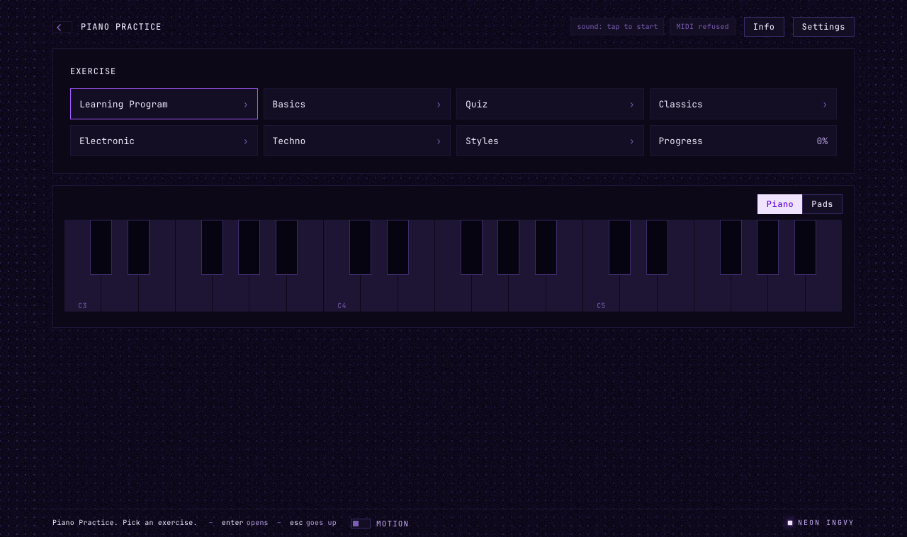
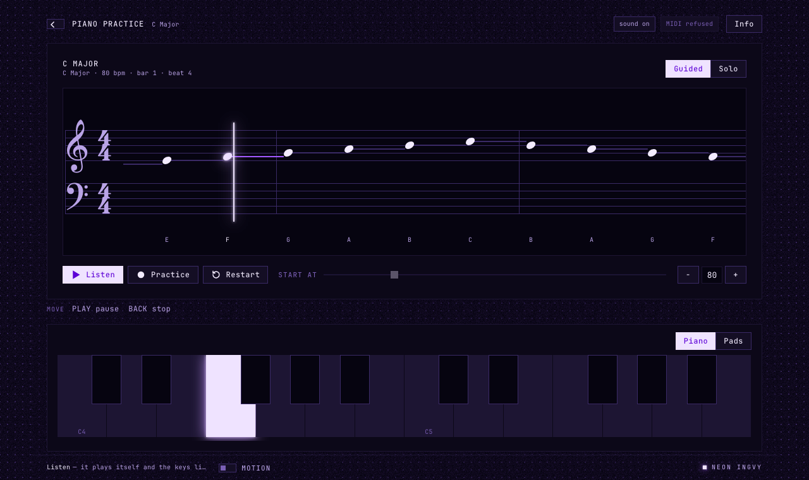
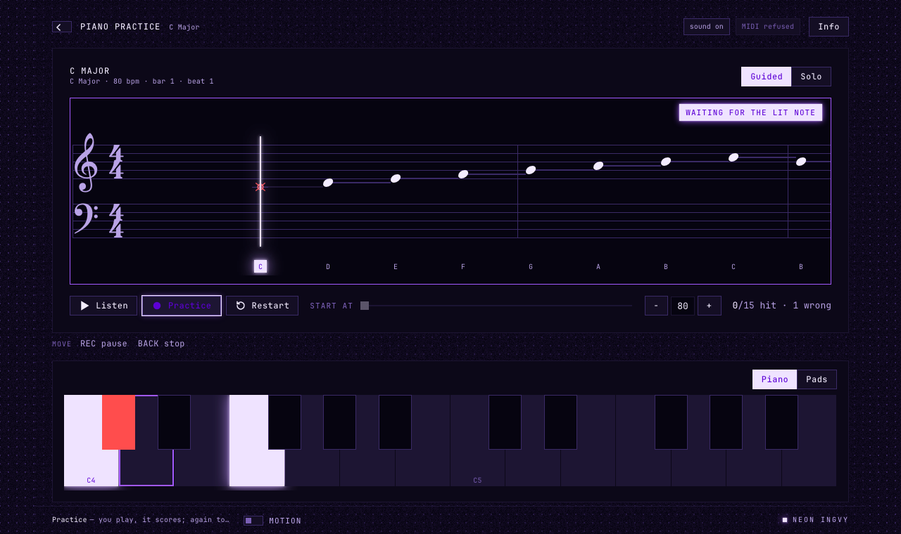
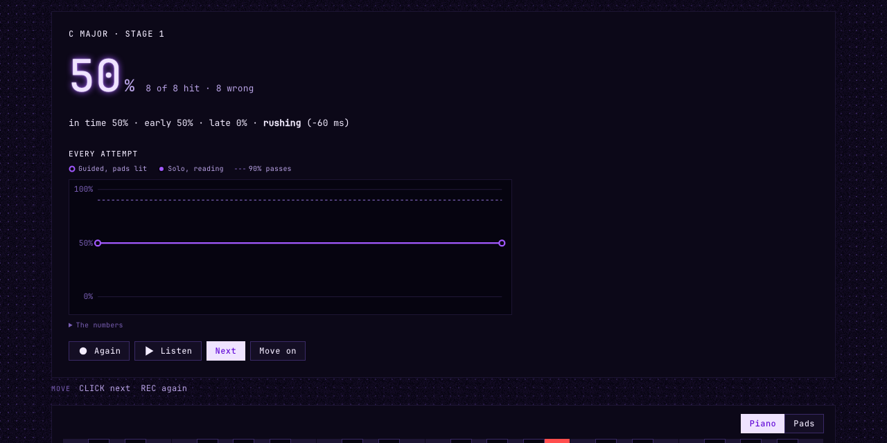
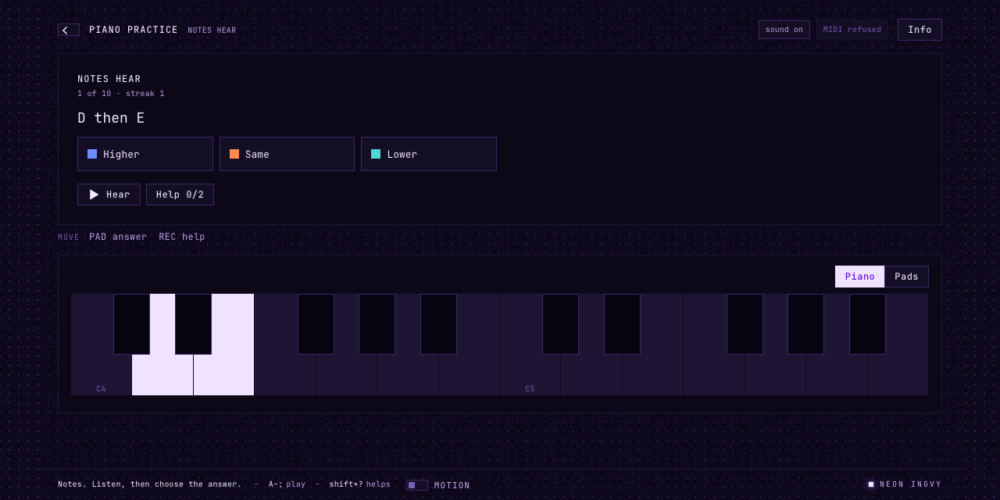
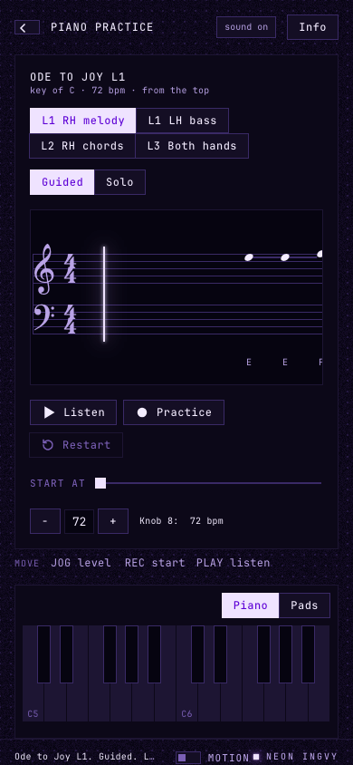

# Piano Practice in your browser

Piano Practice runs on the Ableton Move, and the same practice runs in a web
browser: the same lessons, the same Path, the same scoring, and the
same piano. This page walks through it from the first click.



## What it is, and what it is not

The browser page is **the module itself, not a copy of it**. The part of Piano
Practice that decides what happens — the lesson tree, the transport, the
judging of every note, the quizzes, your progress — is one file of JavaScript
(`src/session.mjs`). The Move runs it behind its pads and its 128×64 screen; the
page runs it behind a keyboard and a window. The piano you hear is the Move's
own synth too, compiled for the web.

So what you learn here transfers. The screens come in the same order, the
buttons mean the same things, and a lesson's progress is counted the same way.

What the page keeps is kept **in this browser**: settings, progress and quiz
rounds are stored on this computer, not on your Move. Opened from the Move
itself, the page works on the Move's session instead; see
[The Move from the page](#the-move-from-the-page).

## Starting it

The page is built from this repository:

```sh
npm install
npm run web:dev          # http://localhost:47331
```

`web:dev` builds the browser's piano first, which needs Rust with the
`wasm32-unknown-unknown` target (`rustup target add wasm32-unknown-unknown`).
`npm run web:build` writes the finished page to `dist/web/`, which works offline
from any static web server.

**Sound starts on your first click or key press.** Browsers do not let a page
make sound before you have touched it, so the top bar says *sound: tap to
start* until you do, then *sound on*.

## Finding your way

The window has four parts:

| | |
| --- | --- |
| **The top bar** | Back (‹), where you are, the sound and MIDI status, **Info** and, on the list, **Options** and **Settings** |
| **The screen** | the list, a piece, a quiz, a result — whatever the session is on. Under it, marked *Move*, the line the Move shows at the bottom of its screen: the Move's keys for this screen |
| **The keys** | a piano keyboard, or the Move's pads (the switch at their top right) |
| **The hint bar** | what the keys do on this screen, what the thing under the pointer does, and what just happened |

The list is a tree: click a folder to open it, **Back** (or Escape) to go up.
Its top is the same as on the Move: **Continue**, **Path**, **Practice**,
**Quiz**, **Progress**, **Settings**. [Finding your way](finding-your-way.md)
walks through it.

**Info** (or I) is the Move's Menu: help for whatever is in front of you —
what the screen is and its keys first, then the highlighted lesson, the piece
or the quiz, and the words it uses. **Options** (or Shift+Enter) is the Move's
Shift + click: what you can do with the highlighted row besides opening it —
skip what you know, start the path at a stage, test out of a stage at its
checkpoint. Choose one, or **Close**.

The first time you open the page it welcomes you as the Move does, in three
pages, the last asking whether you are new to piano; and a few screens show a
one-card tip the first time. **Next**, **Go on** or **Close** leave them.

## Your first piece

Open **Practice › Scales › Major › Up & down**. The piece is *armed*: its notes
wait to the right of the hit line, and nothing moves yet.



- **Listen** (Shift+Space) plays it for you. The staff scrolls, the piano
  sounds, and the keys light as each note is played. Press it again to pause.
- **Practice** (Space) is your turn. Four beats count you in, then the notes
  scroll towards the hit line and you play each one as it arrives.
- **Restart** (Escape while it runs) goes back to the top.

Two stages decide how much help you get:

| | |
| --- | --- |
| **Stage 1 · lit** | the next note lights on the keys (an outline) before you need it |
| **Stage 2 · read** | nothing lights — you read the staff |

A stage is **passed** at 90%. Pass stage 1 and the lesson shows ◐; pass stage
2 and it shows ✓.

### Playing

Play from whatever you have:

- **The computer keyboard**: the home row is the white keys and the row above
  the black ones, from middle C — `A S D F G H J K` is C D E F G A B C, and
  `W E T Y U` the sharps between. **Z** and **X** move it down and up an octave.
  It works by key *position*, so it keeps its shape on any keyboard layout.
- **The keys on screen**: click, or drag across them for a glissando. Where on
  a key you press sets how loud: near the front is loud.
- **A MIDI keyboard**: plug it in; the top bar names it. Any channel works.
- **Your Move, on its USB cable**: the page recognises it and reads its pads
  as the module does, so a pad plays the note it plays on the Move.

### When you miss a note



With **Wait** on (the default), the music **stops on a note you have not
played**, lights it, names it under the staff, and waits. Play it and the
music carries on in tempo. A note played late still scores as late — Wait is
there so you can find the note, not to forgive it.

Every press leaves a small ring on the staff where it happened, so the gap
between a ring and its note is your timing. A wrong note flashes red on the
key; an open notehead is a hit, a red ✗ a miss.

### Starting somewhere else

While the music is stopped, the **Start at** slider picks the bar to begin
from. A run that does not start at the top is practice on a passage: it is not
recorded. **−** and **+** change the tempo of generated drills; a song keeps the
tempo it was written at.

## Results



A whole run ends on its result: your score, and **every attempt** you have made
at this piece on a fixed 0–100% scale — hollow points are stage 1, solid points
stage 2, and the dashed line is the 90% that passes. Hover a point for its
date and tempo; *The numbers* opens them as a table.

| | |
| --- | --- |
| **Again** | the same stage again |
| **Listen** | hear it |
| **Next** | stage 2 if you have just passed stage 1, otherwise the next step of the Path |
| **Move on** | count stage 1 as enough (or skip), and go on |

## Quizzes

**Quiz** has three folders, each a different skill:

- **Ear** — something is played; say what it was. Grouped by topic: Pitch &
  melody, Intervals, Chords, Scales & keys. The three courses sit in their
  topic: **Identify intervals** (2nds to two octaves) and **Compare intervals**
  (which of two is bigger, from a fixed or a random root) under Intervals,
  **Identify scales** (major and minor, then the modes) under Scales & keys.
- **Reading** — the same three courses on the staff: read an interval, compare
  two, read a scale, and choose the answer. **Hear** plays what is written,
  and the first listen counts as help. Then **Notes by staff** and **Chords by
  staff**: a row of notation, only the written notes count.
- **Keys** — **Notes by alphabet** and **Chords by name** show only the name,
  and any octave or inversion counts: play the first and the row moves on.
  **Name notes** and **Name chords** light a key; choose its name. **Help**
  names the first one, then lights its keys.



In **Ear**, each answer has a colour — the colour its pad has on the Move.
Choose one; a wrong answer is counted once and the question stays until you get
it. When you are right, the notes light on the keyboard, so what you heard is
connected to where it sits. **Hear** plays the question again; **Help** is a
ladder of hints — the round still counts, but it records how many you took.

A round is ten, twenty or thirty answers (Settings › Round). Its result is how
many you got right a minute, beside your best, and how many of your attempts
were right — two charts, so speed and success can each be read on their own.
Under them, **Each answer** has a bar per interval, scale, note or chord: how
often it was right first time over every round, with a mark where this round
put it. Progress shows the same bars for a drill between rounds.

## The Path and Progress

**Continue**, at the top of the list, names and opens the next step of a path
in five stages, from the grid and the staff to extended harmony, with nothing
locked. When a review is due it reads **Review**, and reviews and new steps take
turns. Each stage ends with its **Checkpoint**; **Options** on a stage offers
**Test out: checkpoint** and **Start the path here**. Every exercise is
described in [the curriculum](curriculum.md). **Path › Review** lists the
finished lessons that are due again.

**Progress** shows how far you have got: overall, per stage, and every lesson
you have played, each with its chart.

## Settings

**Settings** opens the Move's folder of groups: Path, Practice, Sound, Pads,
MIDI and Help. Open one; **−** and **+** change a row. In the browser **MIDI**
holds what this browser plays from, since the Move's two MIDI routes do not
apply here. **Help** has **Show tips again** and **Welcome again**. The most
useful:

| | |
| --- | --- |
| **Tempo**, **Key**, **Scale**, **Octave** | what the generated drills are made from |
| **Wait** | stop on a missed note (on) |
| **Grace** | how late a note may be and still count, in beats |
| **Click**, **Reference** | a metronome, and the piece played softly as you play it |
| **Round** | answers per quiz round |
| **Auto info** | show a lesson's help the first time you open it |

## On a phone or a tablet



The page fits a phone: one column, the staff packed tighter so the next bars
are in view, the keyboard two octaves wide. Tap the keys, or connect a MIDI
keyboard where the browser supports Web MIDI.

## The Move from the page

The same page ships inside the module. Opened through Schwung's web manager, it
works on the session running **on the Move**: the Move makes the sound and
reads its pads, and the page shows that session large and lets you steer it.

1. On the Move, open Piano Practice: **Shift + Step 13** for the Tools menu,
   then pick it.
2. On a laptop on the same network as the Move (or connected by its USB
   cable), open **http://move.local:7700/remote-ui** and choose the **Tool**
   tab.

The page now follows the Move. Turn the jog on the Move and the page's list
moves with it; click a lesson on the page and the Move opens it. The page's
keys play on the Move, so you hear them through the Move's piano or whatever
**MIDI out** sends them to. Settings, progress and quiz rounds are the Move's:
nothing is kept in the browser in this mode.

Some things stay with the Move's own buttons:

- **Closing the tool.** Back at the top of the list closes Piano Practice on
  the Move. From the page it does nothing, so a click cannot end your session.
- **Timing.** The page draws the scrolling staff from the Move's clock, and
  shows changes within a fraction of a second. For practice, play on the pads
  or a keyboard plugged into the Move: those are judged on the Move, at once.

How the page and the Move talk is described in [schwung-web.md](schwung-web.md).

## Keys at a glance

| Key | |
| --- | --- |
| `A`–`;`, `W E T Y U O P` | play |
| `Z` / `X` | octave down / up |
| Space | Practice (again to pause) |
| Shift+Space | Listen (again to pause) |
| Enter | open, or Next on a result |
| Shift+Enter | Options for the highlighted row; Move on, on a result |
| Escape | Back; restart a running piece |
| Arrow keys | move the highlight; on a piece, the stage |
| I | Info |
| Shift+? | a quiz's help |
