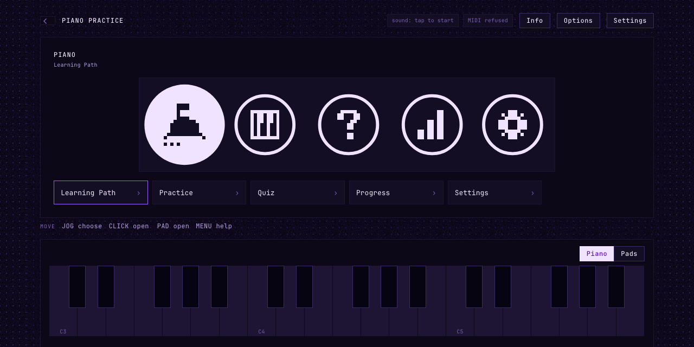
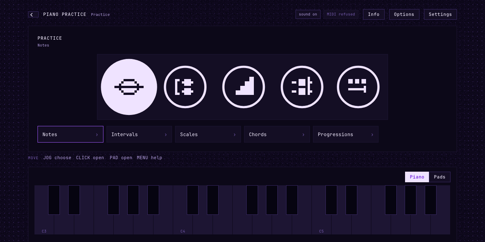
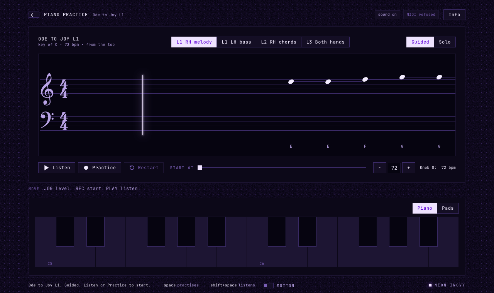
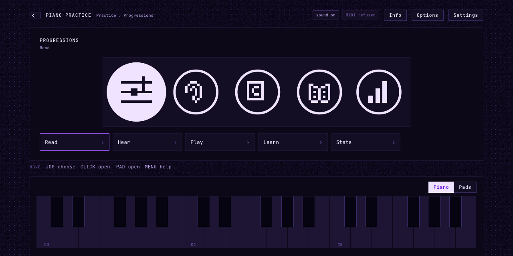
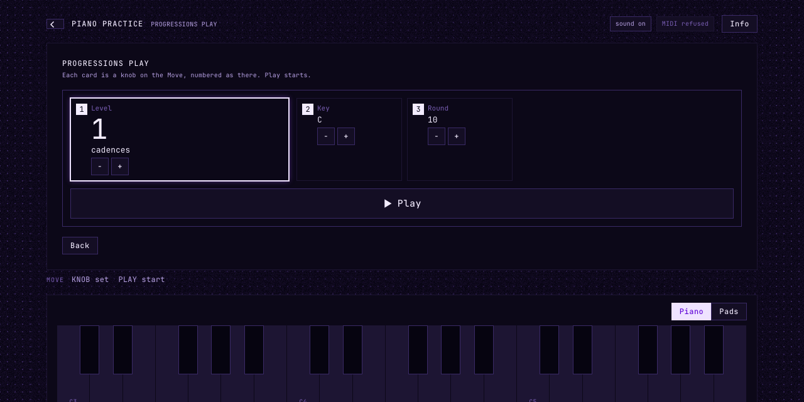
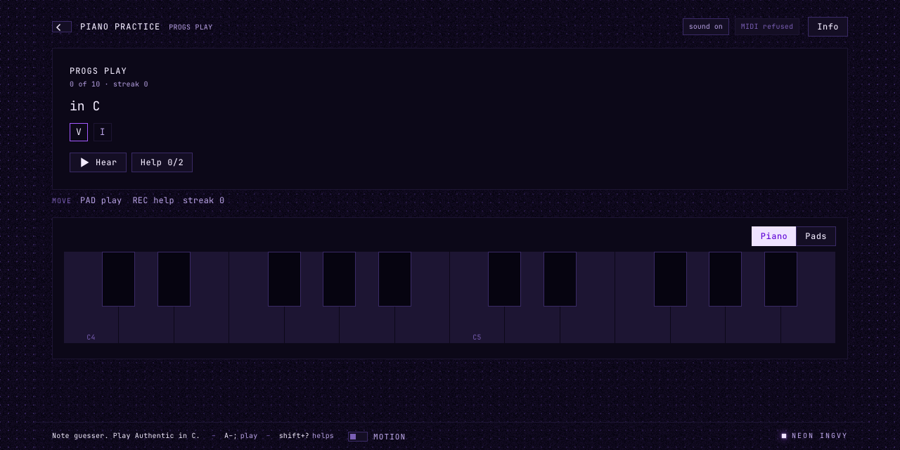
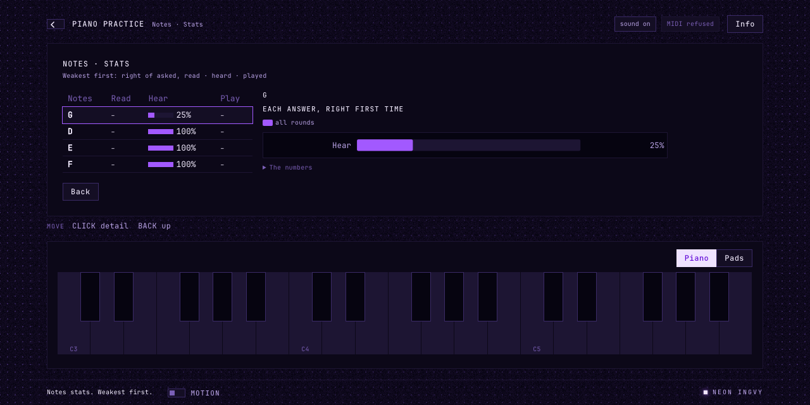
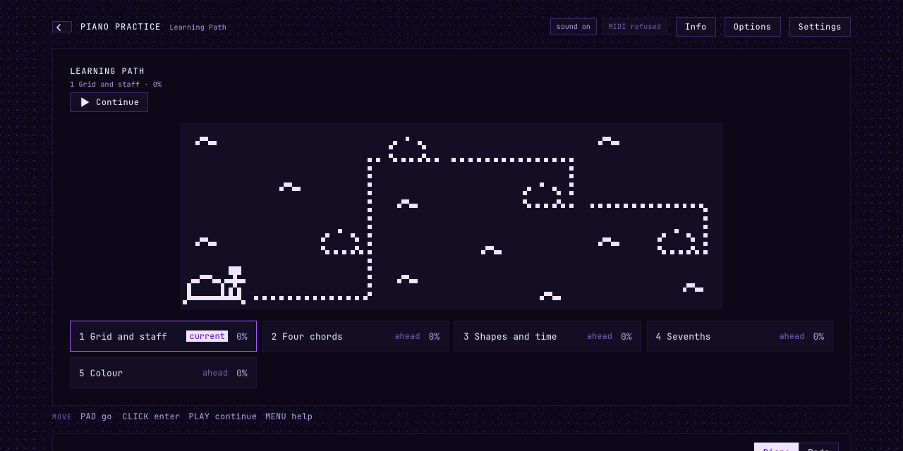
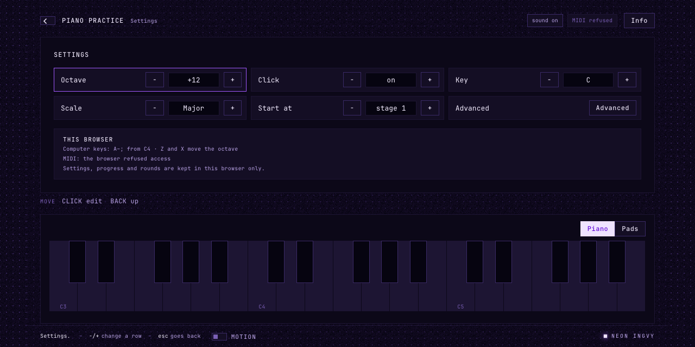

# Piano Practice in your browser

Piano Practice runs on the Ableton Move, and the same practice runs in a web
browser: the same lessons, the same Learning Path, the same scoring, and the
same piano. This page walks through it from the first click.



## What it is, and what it is not

The browser page is **the module itself, not a copy of it**. The part of Piano
Practice that decides what happens — the lesson tree, the transport, the
judging of every note, the quizzes, your progress — is one file of JavaScript
(`src/session.mjs`). The Move runs it behind its pads and its 128×64 screen; the
page runs it behind a keyboard and a window. The piano you hear is the Move's
own synth too, compiled for the web.

So what you learn here transfers. The screens come in the same order, the
buttons mean the same things, and a lesson's progress is counted the same way.

What the page keeps is kept **in this browser**: settings, progress and quiz
rounds are stored on this computer, not on your Move. Opened from the Move
itself, the page works on the Move's session instead; see
[The Move from the page](#the-move-from-the-page).

## Starting it

The page is built from this repository:

```sh
npm install
npm run web:dev          # http://localhost:47331
```

`web:dev` builds the browser's piano first, which needs Rust with the
`wasm32-unknown-unknown` target (`rustup target add wasm32-unknown-unknown`).
`npm run web:build` writes the finished page to `dist/web/`, which works offline
from any static web server.

**Sound starts on your first click or key press.** Browsers do not let a page
make sound before you have touched it, so the top bar says *sound: tap to
start* until you do, then *sound on*.

## Finding your way

The window has four parts:

| | |
| --- | --- |
| **The top bar** | Back (‹), where you are, the sound and MIDI status, **Info** and, on home and the list, **Options** and **Settings** |
| **The screen** | home, the list, a piece, a quiz, a result — whatever the session is on. Under it, marked *Move*, the line the Move shows at the bottom of its screen: the Move's keys for this screen |
| **The keys** | a piano keyboard, or the Move's pads (the switch at their top right) |
| **The hint bar** | what the keys do on this screen, what the thing under the pointer does, and what just happened |

The page opens on **home**, as the Move does: five circles, **Learning Path**,
**Practice**, **Songs**, **Progress** and **Settings**, drawn from the Move's
own pictures. Click a circle, or its row below, to open it; the arrow keys
choose (the chosen circle grows) and Enter opens. Behind each circle the list
is a tree: click a folder to open it, **Back** (or Escape) to go up, and Back
from a section returns home with its circle chosen. **Practice**, each of its
trainers and **Songs** are rings of their own, spaced by their count as on the
Move; their folders below are lists.


[Finding your way](finding-your-way.md) walks through it.

**Info** (or I) is the Move's Menu: help for whatever is in front of you —
what the screen is and its keys first, then the highlighted lesson, the piece
or the quiz, and the words it uses. **Options** (or Shift+Enter) is the Move's
Shift + click: what you can do with the highlighted row besides opening it —
skip what you know, start the path at a stage, test out of a stage at its
checkpoint. Choose one, or **Close**.

The first time you open the page it welcomes you as the Move does, in three
pages, the last asking whether you are new to piano; and a few screens show a
one-card tip the first time. **Next**, **Go on** or **Close** leave them.

## Your first piece

Open **Practice › Scales › Major › Up & down**. The piece is *armed*: its notes
wait to the right of the hit line, and nothing moves yet.


- **Listen** (Shift+Space) plays it for you. The staff scrolls, the piano
  sounds, and the keys light as each note is played. Press it again to pause.
- **Practice** (Space) is your turn. Four beats count you in, then the notes
  scroll towards the hit line and you play each one as it arrives.
- **Restart** (Escape while it runs) goes back to the top.

**Guided** and **Solo** decide how much help you get:

| | |
| --- | --- |
| **Guided** | the next note lights on the keys (an outline) before you need it |
| **Solo** | nothing lights — you read the staff |

Each is **passed** at 90%. Pass Guided and the lesson shows ◐; pass Solo and
it shows ✓.

A song opens the same way, straight onto its ready screen, on the first
level you have not learned. Its levels are buttons above the staff —
**L1 RH melody**, **L1 LH bass**, **L2 RH chords**, **L3 Both hands** —
with a ✓ on those learned; the arrow keys walk them with Guided and Solo, as
the jog does on the Move.



### Playing

Play from whatever you have:

- **The computer keyboard**: the home row is the white keys and the row above
  the black ones, from middle C — `A S D F G H J K` is C D E F G A B C, and
  `W E T Y U` the sharps between. **Z** and **X** move it down and up an octave.
  It works by key *position*, so it keeps its shape on any keyboard layout.
- **The keys on screen**: click, or drag across them for a glissando. Where on
  a key you press sets how loud: near the front is loud.
- **A MIDI keyboard**: plug it in; the top bar names it. Any channel works.
- **Your Move, on its USB cable**: the page recognises it and reads its pads
  as the module does, so a pad plays the note it plays on the Move.

### When you miss a note


With **Wait** on (the default), the music **stops on a note you have not
played**, lights it, names it under the staff, and waits. Play it and the
music carries on in tempo. A note played late still scores as late — Wait is
there so you can find the note, not to forgive it.

Every press leaves a small ring on the staff where it happened, so the gap
between a ring and its note is your timing. A wrong note flashes red on the
key; an open notehead is a hit, a red ✗ a miss.

### Starting somewhere else

While the music is stopped, the **Start at** slider picks the bar to begin
from. A run that does not start at the top is practice on a passage: it is not
recorded. **−** and **+** change the tempo, as knob 8 does on the Move: a
drill's Tempo setting, or a song's own tempo for the session (opened again, a
song is back at its written tempo). Beside them the ready view says it as the
Move's ready box does: *Knob 8: 80 bpm*.

## Results


A whole run ends on its result: your score, and **every attempt** you have made
at this piece on a fixed 0–100% scale — hollow points are Guided, solid points
Solo, and the dashed line is the 90% that passes. Hover a point for its
date and tempo; *The numbers* opens them as a table.

| | |
| --- | --- |
| **Again** | the same stage again |
| **Listen** | hear it |
| **Next** | Solo if you have just passed Guided, otherwise the next step of the Learning Path |
| **Move on** | count Guided as enough (or skip), and go on |

## Trainers

**Practice** is five trainers — Notes, Intervals, Scales, Chords and
Progressions — each the same five circles: **Read**, **Hear**, **Play**,
**Learn** and **Stats**.



**Read**, **Hear** and **Play** open the setup box, as on the Move: a
**Level** card with its big number and what the level adds, and a card for
each setting the circle has — nothing for the rest. Each card carries the
number of the knob that turns it on the Move, its value, and **−** and **+**
to step it. The big **Play** starts a round; while a Custom pick is too small
it waits and says why. It remembers what you set.



A round of naming offers its answers as buttons, each in the colour its pad
has on the Move. Choose one; a wrong answer is counted once and the question
stays until you get it. When you are right, the notes light on the keyboard,
so what you heard is connected to where it sits. **Hear** plays the question
again; **Help** is a ladder of hints — the round still counts, but it records
how many you took.


A round of playing is a row, as on the Move: names to find, notes on the staff,
a scale filling the staff as you play it, or a progression's numerals, each
marked as its chord goes down.



A round is ten, twenty or thirty right answers (the setup's **Round**). Its
result is how many you got right a minute, beside your best, and how many of
your attempts were right. Under them, **Each answer** has a bar per note,
interval, scale, chord or progression: how often it was right first time over
every round, with a mark where this round put it.

**Stats** lists everything the trainer has asked, weakest first, a bar each for
read, heard and played; click a row for its chart.



The walk-through is [Practice: five trainers](trainers.md).

## The Learning Path and Progress

**Learning Path** is a map, as on the Move: an island for each stage, and on an
island a place for each unit and a fort for the checkpoint, drawn from the
same pixels. Click a place and your avatar walks there along the dotted
route; click it again to go in. The arrow keys walk, Enter goes in, Escape
goes back up, and **Continue** above the map (or Shift+Space, the Move's
Play) opens your next step. Under the map every place is listed with its
state and percent, and clicking one does the same. **Options** offers
**Show as list**, where Continue is the first row and Review lives.



The way moves as on the Move: a stage zooms in from the world and out again,
a finished place raises its flag and the avatar walks on, a finished stage
sets off fireworks and its banner, and the whole path ends in the finale, all
drawn by the same engine. A click or any key skips a scene.

**Continue** opens the next step of a path in five stages, from the grid and
the staff to extended harmony, with nothing locked. When a review is due it
opens the **Review** instead, and reviews and new steps take turns. Each stage ends with its **Checkpoint**; **Options** on a stage offers
**Test out: checkpoint** and **Start the path here**. Every exercise is
described in [the curriculum](curriculum.md). **Learning Path › Review** lists the
finished lessons that are due again.

**Progress** shows how far you have got: overall, per stage, and every lesson
you have played, each with its chart.

## Settings

**Settings** opens the Move's short page: **Octave**, **Click**, **Key**,
**Scale** and **Start at**; **−** and **+** change a row, there and then. The
page also holds what this browser plays from (**This browser**), since the
Move's two MIDI routes do not apply here. **Advanced**, its last row, opens
the rest in groups, as on the Move; Escape goes back a step at a time.



| | |
| --- | --- |
| **Octave**, **Key**, **Scale** | the pads' octave, and what the free library is made in |
| **Click** | the metronome |
| **Start at** | where the Learning Path starts |
| **Advanced › Practice** | Tempo, Read ahead, Any octave, Wait, Grace, Count in, Names, Round |
| **Advanced › Sound** | Reference (the piece played softly as you play it), Ref vol, Quiz sounds |
| **Advanced › MIDI** | where the Move sends the notes (on the page here: This browser) |
| **Advanced › Help** | Auto info, Show tips again, Welcome again |

## On a phone or a tablet


The page fits a phone: one column, the staff packed tighter so the next bars
are in view, the keyboard two octaves wide. Tap the keys, or connect a MIDI
keyboard where the browser supports Web MIDI.

## The Move from the page

The same page ships inside the module. Opened through Schwung's web manager, it
works on the session running **on the Move**: the Move makes the sound and
reads its pads, and the page shows that session large and lets you steer it.

1. On the Move, open Piano Practice: **Shift + Step 13** for the Tools menu,
   then pick it.
2. On a laptop on the same network as the Move (or connected by its USB
   cable), open **http://move.local:7700/remote-ui** and choose the **Tool**
   tab.

The page now follows the Move. Turn the jog on the Move and the page's list
moves with it; click a lesson on the page and the Move opens it. The page's
keys play on the Move, so you hear them through the Move's piano or whatever
**MIDI out** sends them to. Settings, progress and quiz rounds are the Move's:
nothing is kept in the browser in this mode.

Some things stay with the Move's own buttons:

- **Closing the tool.** Back at home closes Piano Practice on
  the Move. From the page it does nothing, so a click cannot end your session.
- **Timing.** The page draws the scrolling staff from the Move's clock, and
  shows changes within a fraction of a second. For practice, play on the pads
  or a keyboard plugged into the Move: those are judged on the Move, at once.

How the page and the Move talk is described in [schwung-web.md](schwung-web.md).

## Keys at a glance

| Key | |
| --- | --- |
| `A`–`;`, `W E T Y U O P` | play |
| `Z` / `X` | octave down / up |
| Space | Practice (again to pause) |
| Shift+Space | Listen (again to pause) |
| Enter | open, or Next on a result |
| Shift+Enter | Options for the highlighted row; Move on, on a result |
| Escape | Back; restart a running piece |
| Arrow keys | move the highlight; on a piece, the stage |
| I | Info |
| Shift+? | a quiz's help |
